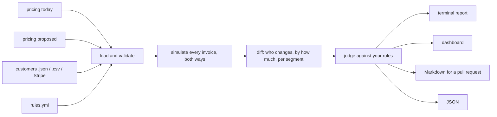

# blast

**See which customers a pricing change hits before you ship it.**

You give blast your pricing as it is, your pricing as proposed, and your
customers. It prices every customer both ways and tells you who is affected,
how much money moves, and which of your own rules the change would break. It
runs on your machine: no server, no account, no telemetry.

## What it looks like

```
$ blast check
 pricing.old.yml → pricing.new.yml
 10 customers simulated
 ────────────────────────────────────────────────────────────
  Segment             Affected   Revenue change
  annual + referred          5         -$644.40
  monthly                    0            $0.00
  legacy plans               1         -$158.00
  has coupon                 2         -$230.40
 ────────────────────────────────────────────────────────────
  Customer   Plan                    Old       New     Change
  c3         pro annual          $990.00   $792.00   -$198.00
  c4         pro annual          $891.00   $712.80   -$178.20   ✗ max-one-discount
  c6         legacy-pro annual   $790.00   $632.00   -$158.00   ✗ no-legacy-repricing
  c8         starter annual      $290.00   $232.00    -$58.00
  c7         starter annual      $261.00   $208.80    -$52.20   ✗ max-one-discount
 ────────────────────────────────────────────────────────────
  Blast radius  ██████████░░░░░░░░░░  5 of 10 customers (50%)
  Revenue       $5,229.00 -> $4,584.60  (-$644.40, -12.3%)

  ✗ max-one-discount      2 customers: c4, c7
  ✗ no-legacy-repricing   1 customer: c6
  ✓ finance-approval      not triggered

 2 of 3 rules broken · exit code 1
```

`blast dash` shows the same result full screen and re-simulates the moment you
save a file, so you can watch a fix turn the frame from red to green.

## Install

```sh
go install github.com/dilaziz/blast/cmd/blast@latest
```

Or from a checkout: `make build`, which writes `bin/blast`.

## Try it in a minute

```sh
blast init        # an example: 10 customers, a risky change, 3 rules
blast check       # exit code 1: two rules are broken
blast dash        # browse it; edit pricing.new.yml and watch it rerun
```

The proposal in the example adds one discount:

```yaml
discounts:
  WELCOME10: { percent: 10 }
  REFERRAL20:
    percent: 20
    when: billing == "annual" and referred
```

and the rules it has to respect are three lines of policy:

```yaml
rules:
  - name: max-one-discount
    never: customer.discount_count > 1
  - name: no-legacy-repricing
    never: plan.legacy and invoice.new != invoice.old
  - name: finance-approval
    require: approval("finance")
    when: diff.touches("payment")
```

[docs/walkthrough.md](docs/walkthrough.md) takes you from there to your own
data, Stripe, and pull-request checks.

## How it works



- **Exact money.** Every amount is a whole number of cents. No floats, so no
  off-by-a-cent surprises. Rounding is half up after each discount;
  [docs/pricing-model.md](docs/pricing-model.md) has the worked example.
- **Your rules, in a small language** written for this: `never:` and
  `require:` conditions, checked before anything runs. A typo is an error
  with a file and line, not a rule that silently never fires.
- **Exit codes for CI:** 0 every rule passes, 1 a rule broke, 2 bad input.
- **One pricing file is enough:** `blast check --base main --after
  pricing.yml` compares your working copy with a git revision.

## What it does not do (yet)

- Tax, proration, trials, credits, usage-based or tiered prices.
- More than one plan per customer, or billing periods other than monthly and
  annual.
- Multiple currencies in one run. Amounts are shown with `$`.
- Predict behaviour. blast tells you what invoices become, not who churns.

## Privacy

Customer data never leaves your machine. blast makes no network calls, with
two exceptions you ask for by name: `blast import stripe` reads from
`api.stripe.com` with a read-only key ([docs/stripe.md](docs/stripe.md)), and
`--explain` talks to an Ollama on `127.0.0.1`, sending totals and never
customers. [docs/security.md](docs/security.md) covers what was tested.

## License

MIT. See [LICENSE](LICENSE).
